# SmartStudio — make room to create

Design report · 23 October 2026 · Proposal only

## Implemented Task Ribbon

The selected direction is now implemented in the SmartStudio source, including the shared editors and specialist workspaces. These are actual component renders from an isolated development profile, not generated concept images. No installer or live store was changed. The proposal sections below remain as design history; current behaviour and validation are documented in SmartStudio/docs/task-ribbon.md.

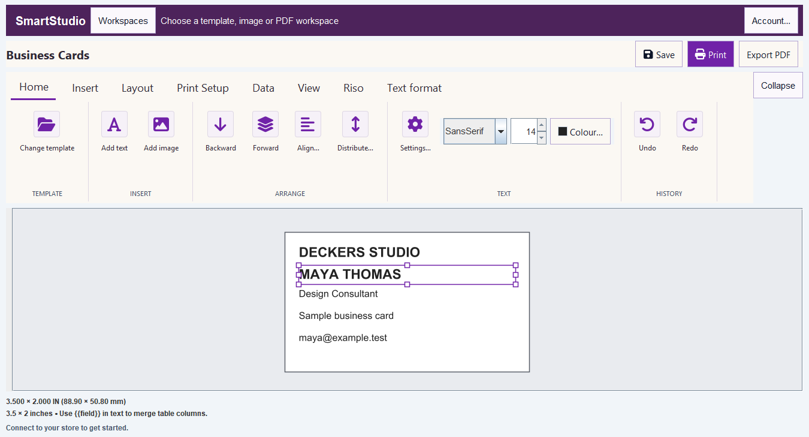

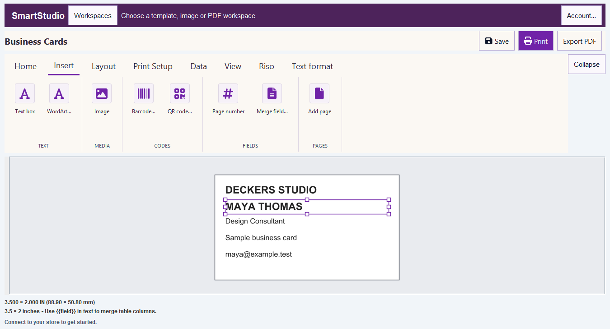

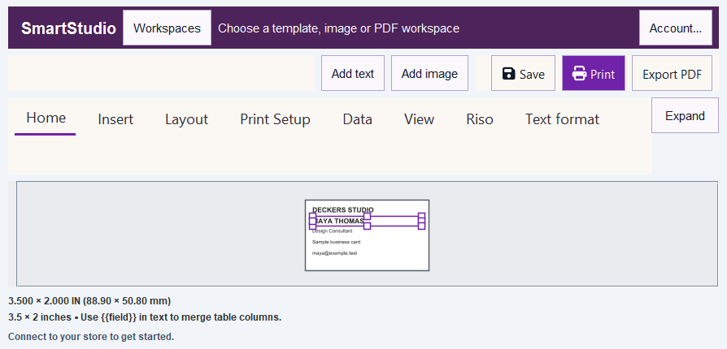

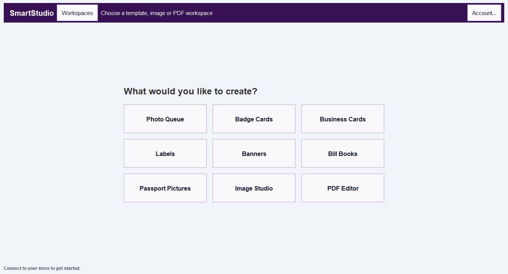

The compact screenshot uses a 910 × 469 logical window to inspect constrained layout; it is not a physical 150% DPI test. The sample card uses synthetic data. The disconnected status is intentional in the isolated preview.

## Recommendation

**Selected direction: Task Ribbon (concept 2).** Keep its existing Home tool groups and add a dedicated tab row, including an independent Insert tab. The Deckers Studio panel studies below remain earlier explorations; the revised Task Ribbon previews in the next section are the current visual direction. Application source implementation is now complete; see the implementation section above.

The original proposal images below describe design exploration. Images are illustrative generated concepts, not pixel-accurate specifications or functional screens. Text, synthetic artwork and illustrative logos in them are not replacement brand assets. The written rules below take precedence over image inconsistencies.

## Selected revision — Home and Insert tabs

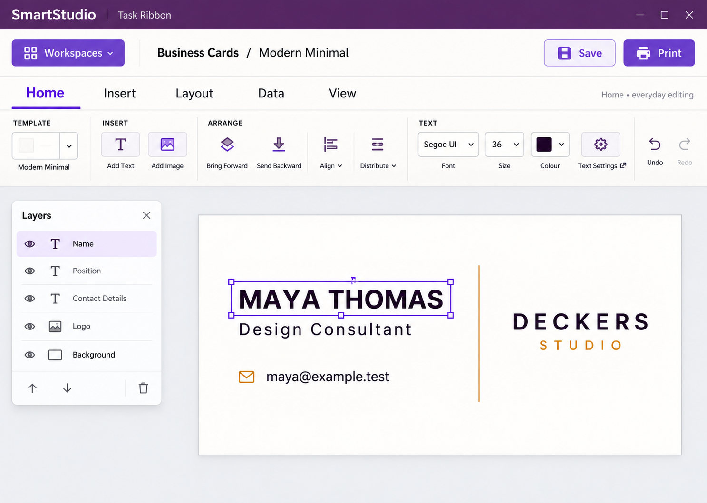

**Home stays familiar.** Retain Template, quick Insert shortcuts (Add text / Add image), Arrange, Text settings and Undo/Redo. Add a tab row above the ribbon: Home, Insert, Layout, Data and View. The document header keeps Workspaces, document/template identity, Save and Print visible when any tab is selected. Do not move these commands into a File menu. The Layers pane stays optional and can be closed to enlarge the canvas.

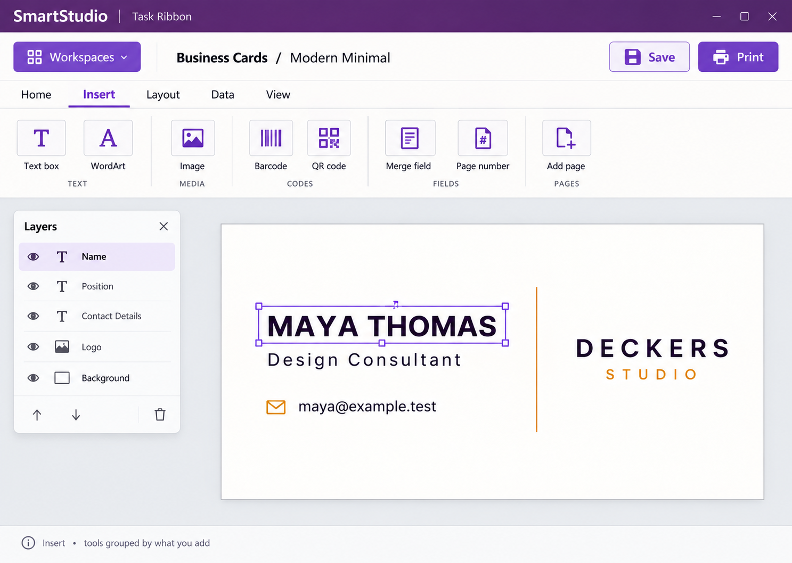

**Insert has its own ribbon.** Text contains Text box and WordArt; Media contains Image; Codes contains Barcode and QR code; Fields contains Merge field and Page number; Pages contains Add page. The Merge field action is a proposed convenience picker for existing text placeholders, not a new merge engine. It inserts a selected existing field into a text object, or creates a text object containing that placeholder when no text is selected. Empty data offers the existing Data → Add field route. Existing template/workspace restrictions still apply.

Home shortcuts and Insert commands invoke the same underlying actions. Adding a feature later adds a labelled command to its relevant group; it does not require expanding Home or creating another toolbar row. Leave unused ribbon space empty, with no disabled Coming soon controls. Use labelled group dialogs when a group grows beyond its width budget. Essential commands stay direct buttons, not overflow-menu-only items.

| Tab | Purpose and grouping |
| --- | --- |
| Home | Template, quick Insert, Arrange, Text, Undo/Redo; preserve the selected concept's hierarchy |
| Insert | Text, Media, Codes, Fields and Pages; creation actions only |
| Layout | Existing template dimensions, page management, object ordering/alignment and print-layout entry points |
| Data | Existing records, fields, Excel connection and number-series workflows; only for workspaces supporting them |
| View | Existing Fit/zoom and Layers visibility; do not promise rulers or guides without separate feature work |

**Specialist tabs:** show Numbering and Riso for applicable bill-book/publication operations; Text format, Picture format and Code format appear after the stable tabs when a compatible object is selected. These contextual tabs use a subtle tinted label and do not automatically steal the user's active tab. If selection becomes incompatible while a contextual tab is active, return to Home. PDF uses its own Pages, Edit, Forms and OCR groups; Image Studio and Passport Pictures retain task-specific commands rather than displaying irrelevant card-design tabs. Preserve the stable Home/Insert pattern only where insertion is meaningful.

**Future extension rule:** register each command once with its label, group, applicable workspace/selection, action and enabled reason; compose tabs from those commands. This is a proposed internal UI organisation, not a public API change. Do not introduce tabs with no usable tools. Keyboard navigation follows the standard tab-strip arrow-key pattern, with Tab entering the selected ribbon. Switching tabs preserves selection, document state and canvas zoom.

**Sizing correction for the tabbed ribbon:** the earlier six-case budget below describes the original sidebar study. The selected ribbon reserves 56 logical units for its document header, 44 for tabs, 128 for its expanded ribbon (104 in compact mode) and 32 for status/zoom. At the tightest estimated 910 × 469 usable size, compact mode leaves 233 units of canvas height. An explicit Collapse ribbon button gives that space back; clicking a tab temporarily opens its bounded ribbon, like office applications. Never auto-collapse while a user is editing a ribbon field. On compact screens, detailed Arrange and Text controls open labelled group dialogs while Add text, Add image, Save and Print remain direct. The sketches show the expanded, spacious state; native measurements remain pending.

The Home and Insert images are two states of the same proposal, not alternatives requiring a second layout choice. Generated differences in font values, sample artwork or ribbon alignment are illustrative; the tab row, command grouping and shared document header are the design contract.

## What the current application tells us

Inspected the working-tree source for the shared shell, navigation, card/publication editors, photo queue, passport workflow and PDF editor. Rendered four existing panels in an isolated development profile from the available compiled classes. Those captures are component renders at 1366 × 700, not screenshots of an authenticated installed application. Build outputs may lag working-tree source; source inspection is the authority for current capability.

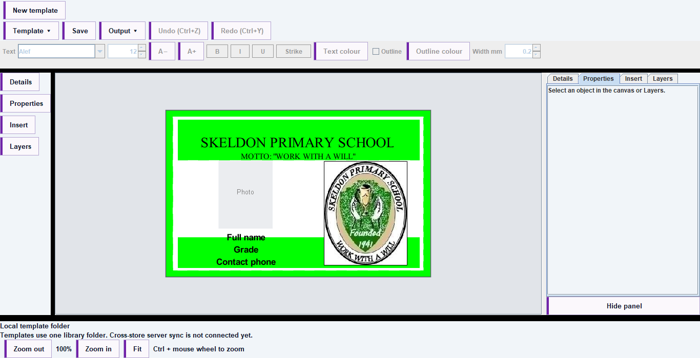

The badge editor spends three rows on commands and text formatting. The same inspector choices appear on both the left rail and right tabs. Printing sits inside Output. A large empty inspector can remain open without a selection. The shared shell also allows horizontal scrolling in the formatting strip.

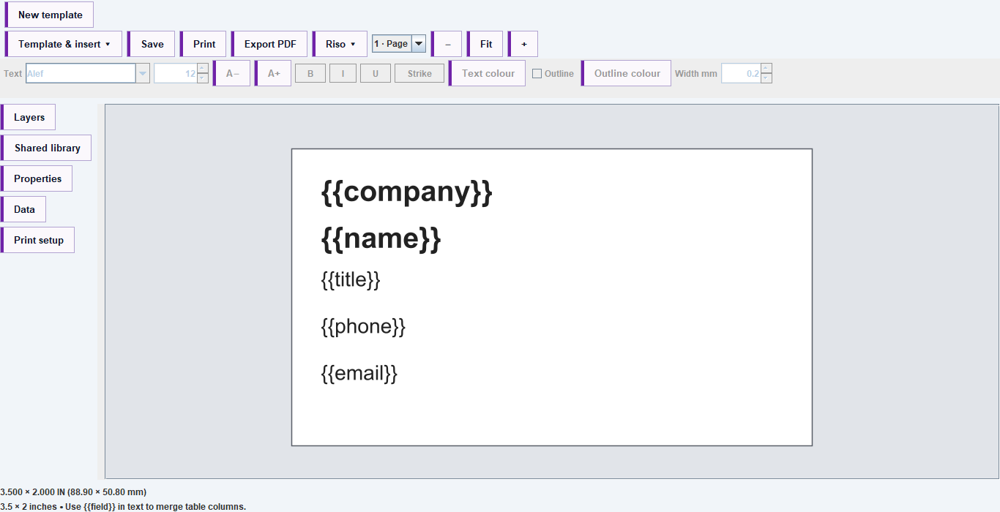

The publication editor already exposes Save, Print and Export PDF, which is worth preserving. Template selection and insertion share a menu. Properties, data, print setup and library status compete as peer inspector sections. The next design should retain capability while separating everyday editing from setup.

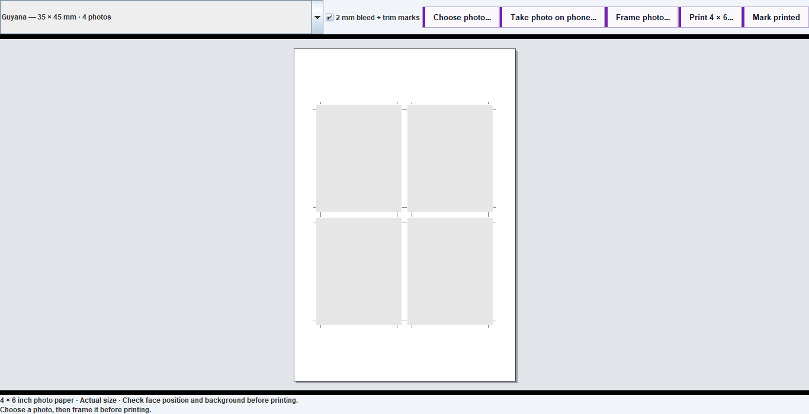

Passport Pictures combines the format selector and its main actions into one long row. A narrower effective viewport can make that row difficult to use. Keep the sheet preview, but group source, framing and output controls by task.

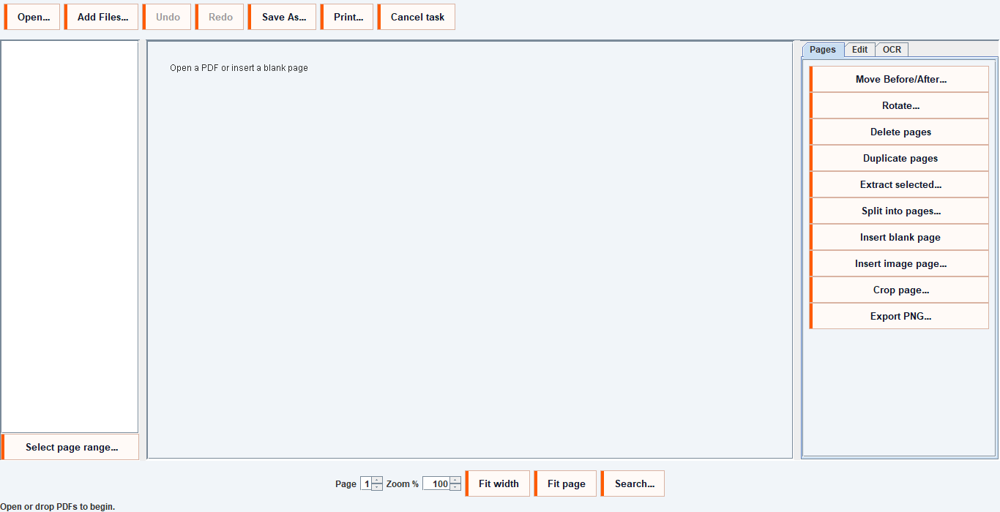

The PDF editor has useful page thumbnails and direct Open, Add Files, Save As and Print actions. Its long action stack and orange accents differ from the purple shared editors. Organising pages deserves a roomier task surface.

The photo queue source explicitly wraps its toolbar in a horizontally scrolling pane. Its Use in Passport Pictures action is important enough to stay visible. The current workspace chooser is a vertical list reached through Change template / workspace; workspace navigation and template selection should become separate destinations.

## Three directions — same business-card task

All concepts show editing Maya Thomas's name on a business card. They compare interaction structure, not identical artwork. All actions must retain existing permission enforcement and document semantics.

### 1 · Deckers Studio

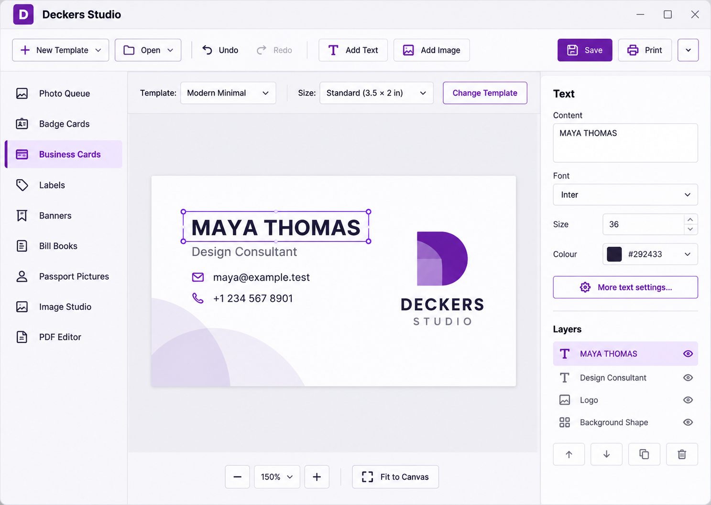

Persistent labelled workspaces on the left, creation and output commands above the canvas, concise selection controls on the right. Best for staff moving among tasks and learning where things live. Costs some canvas width, so the inspector becomes a dialog before controls shrink. Remove duplicate Template selectors shown in the illustration: retain one Change template action and a read-only template name. Replace icon-only layer commands with labelled controls in the Layers dialog.

### 2 · Task Ribbon

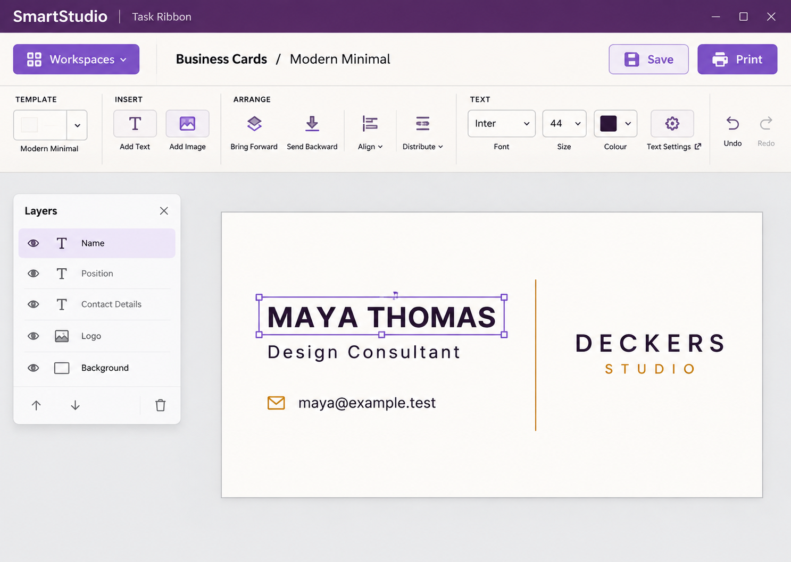

A labelled Workspaces button and broad Template, Insert, Arrange and Text groups. Best discoverability for editing commands and staff familiar with office software. Costs vertical space; use one fixed tool row plus contextual settings on laptops. The illustrated floating Layers window is a manually opened task window, never a permanent overlay over the design. Provide a visible Layers button.

### 3 · Focus Studio

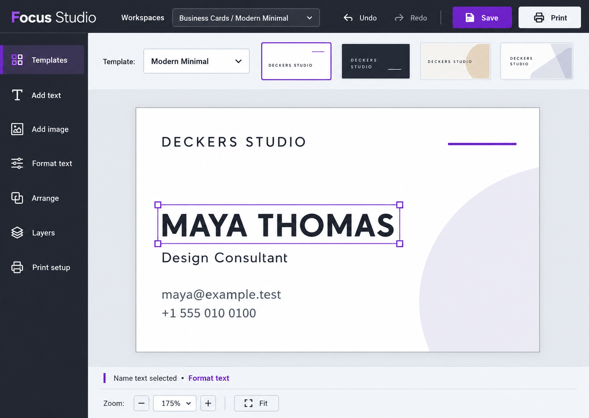

A dark slate header and labelled task rail keep a large canvas visible. Detailed tools open roomy dialogs. Best for repeated production jobs once staff know the tasks; more dialog visits for fine adjustments. Keep the app named SmartStudio; Focus Studio is the concept name only. The decorative template gallery shown in the image should live inside Templates rather than permanently consuming canvas height.

| Direction | Discoverability | Canvas space | Routine tool scrolling | Swing fit |
| --- | --- | --- | --- | --- |
| Deckers Studio | Strong workspace and selection visibility | Good; strongest with compact dialog mode | None by design; long layers/library lists may scroll | Closest to existing split-pane shell |
| Task Ribbon | Strongest visible editing commands | Wide, but less height | None; use task dialogs at small heights | Reorganises existing actions into fixed groups |
| Focus Studio | Clear task names; more steps to settings | Largest unobstructed editing area | None; more dialog navigation | Reuses existing editors in bounded dialogs |

### Proposed colour tokens

| Role | Deckers Studio | Task Ribbon | Focus Studio |
| --- | --- | --- | --- |
| Primary action | #7022A8 | #7022A8 | #7022A8 |
| App background | #F7F6FA | #FBF8F3 | #EEF0F4 |
| Surface | #FFFFFF | #FFFFFF | #FFFFFF |
| Main text | #292433 | #302936 | #252A35 |
| Header / navigation | #FFFFFF | #4D235B | #222631 |
| Selection | #EEE4F6 | #EFE4F2 | #EEE4F6 |
| Accent | #7022A8 | #D49A32 | #A879D2 |

Use white text on primary purple. Amber is decorative emphasis, not small text on white. Use selection labels and outlines as well as colour. Retain existing success, error and warning semantics. Extend shared Deckers theme roles; do not globally change the POS palette or introduce per-panel hard-coded themes.

## Navigation for all nine workspaces

Workspaces is always reachable. Template selection belongs to the current editor, not the workspace chooser. Account, Shared fonts and Check for updates remain under a clearly labelled Account button. Show connection/saving status as text, with details available without consuming multiple footer rows.

| Workspace | Main surface and visible everyday actions | Roomy secondary destination |
| --- | --- | --- |
| Photo Queue | Name/status list + preview; Refresh, Pair phone, Use in Passport Pictures | Paired phones; Photo actions for original, retry cutout and delete |
| Badge Cards | Canvas; Change template, Add text, Add image, Save, Print; existing Undo/Redo | Badge details, Layers, Insert objects, Format selection, Print setup |
| Business Cards | Canvas; Change template, Add text, Add image, Save, Print, Export PDF | Layers, Data, Insert objects, Format selection, Print setup |
| Labels | Same publication shell with correct label dimensions and data | Barcode settings, Data, label-sheet setup |
| Banners | Same shell with large-format size and page controls | Image/size settings, Layers, export/print options supported by this workspace |
| Bill Books | Same shell with page and numbering context | Data/numbering, cut-and-stack, Riso separation and linked sub-pages |
| Passport Pictures | Source controls + sheet; Choose photo, Photo queue, Frame photo, Print 4 × 6 | Format/bleed settings; keep Mark printed separate |
| Image Studio | Original/result canvas; Choose image, Process image, Save PNG, Copy result, Print | Processing settings; performance details and preview background |
| PDF Editor | Page list + document; Open, Add files, Undo, Redo, Save as, Print | Organise pages, Add content, Forms and OCR |

The chooser uses a 3 × 3 grid with readable names and one short description each, not nine tall promotional cards. Tab order follows the visual row order. Workspaces retain their existing editor instances while switching, preserving current retention/clearing rules. Do not introduce new autosave or session persistence as part of this redesign. If an existing switch can lose unsaved work, honour its current guard; before adding a guard, define it against the actual document state.

## Key panel studies

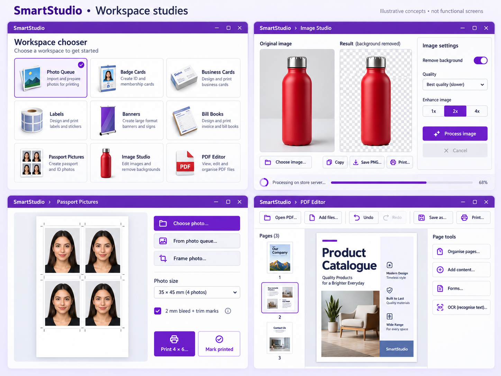

**Shared card/publication editor:** the first concept is the detailed editor preview. Keep the document name, save state, one Change template button, Add text, Add image, Save and Print visible. Export PDF is a labelled secondary action for supported publication workflows. Put shapes/barcodes/QR/photo fields under an explicit Insert objects… dialog; do not remove any existing insertion type. Selection properties show only controls relevant to text, image or barcode. Empty selection says Select an object and offers Add text / Add image rather than showing a blank inspector. Long layer lists scroll inside Layers, with reorder/delete actions fixed outside the list.

**Image Studio:** keep Original, Result and Compare as clearly labelled view choices. At compact widths use a single preview with a view selector; do not squeeze two previews beside a full inspector. Processing settings contain existing quality, edge cleanup, background removal, enhancement and device options. Preserve server-advertised availability. Process image starts work; visible progress and supported Cancel remain next to it. Failed loading clears stale output as today; failed processing never presents the old result as new. Preview backgrounds remain inspection-only and do not alter transparent exports.

**Passport Pictures:** show Source, Frame and Print as groups, not a compulsory wizard. A format change updates the sheet preview. Photo queue routes through the existing queue selection flow. Frame photo opens its existing framing workflow. Print opens setup; Mark printed remains a distinct explicit action and never fires merely because a preview opened or a print dialog was dismissed. Retain current retention rules and face/background review guidance; no claim of automatic official compliance.

**PDF Editor:** keep Open, Add files, Save as and Print direct. Show thumbnails and selected-page count. Organise pages opens a dialog with Move before/after, Rotate, Delete, Duplicate, Extract, Split, Insert blank/image page, Crop and Export PNG available by labelled groups. Add content and Forms retain current capabilities; OCR shows availability/setup status rather than hiding itself. Cancel task appears during supported background work. Empty, loading, failed/password-protected input and unsaved states must be designed using the existing error semantics.

The studies illustrate hierarchy. Their smaller panel images are not proof that four complete apps fit into a single screen. Each panel is proposed as its own workspace. The Image Studio illustration mixes a completed result with running progress: implementation must use separate busy and completed states, disable stale-result output during a new job, and enable Cancel only when the active operation supports it. The chooser's selected tick is illustrative; opening a workspace should use a direct click or keyboard activation, without an extra confirmation step.

## Roomy dialogs, with obvious entry points

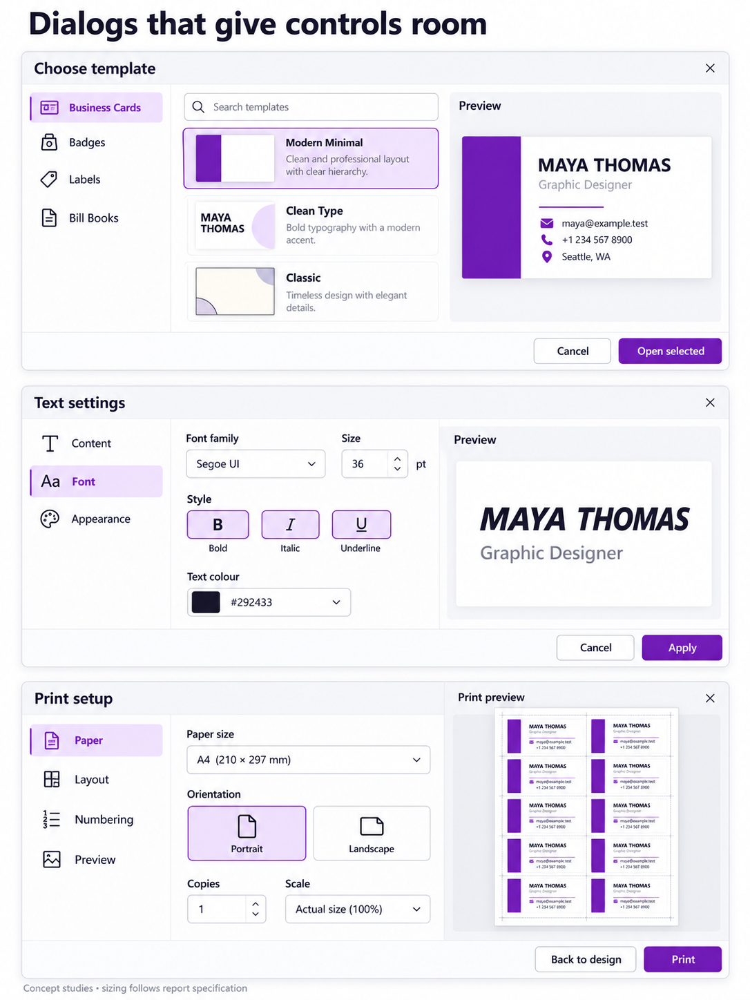

| Dialog | Entry | Body | Completion and return |
| --- | --- | --- | --- |
| Templates | Change template / Open template | Search + library list + preview; New, Open/import and existing folder/shared-library actions | Open selected; Cancel leaves document intact and returns focus to entry button |
| Text settings | Format text… / Edit selection… | Content, Font, Appearance sections; family, size, style, colour, outline and supported sizing controls; selection preview | Apply commits one coherent edit where undo exists; Cancel discards dialog draft; restore selected object and zoom |
| Print setup | Print setup…; Print opens review | Paper, layout, copies and workspace-specific settings + sheet preview; specialised controls split into named sections | Print uses existing printing path; Cancel preserves document; return to same canvas/page |

Use one dialog per task, not nested popup menus. The default is a modal draft editor so the selected object cannot change behind it. Do not apply draft values to the live model on every focus loss. Escape cancels the draft, Enter applies only when focus is not in multiline text, and the close button behaves as Cancel. Native file, colour and printer dialogs may still open from the task dialog. The template illustration shows multiple workspace categories: within an editor, filter to compatible templates and do not silently switch document types. Numbering in Print setup appears only for relevant workflows; it is not a new business-card feature.

At normal sizes use an approximately 840 × 600 dialog, bounded by the usable window. At the tightest target use at most 828 × 416 logical pixels, with a fixed header/footer and approximately 300 pixels for the selected section. Split sections with labelled navigation before reducing font size. Long template/data lists may scroll; fields for a routine task must fit the selected section. Accessibility may require content scrolling at larger-than-target text sizes; never clip the footer to enforce a no-scroll rule.

## Laptop, monitor and scaling adaptations

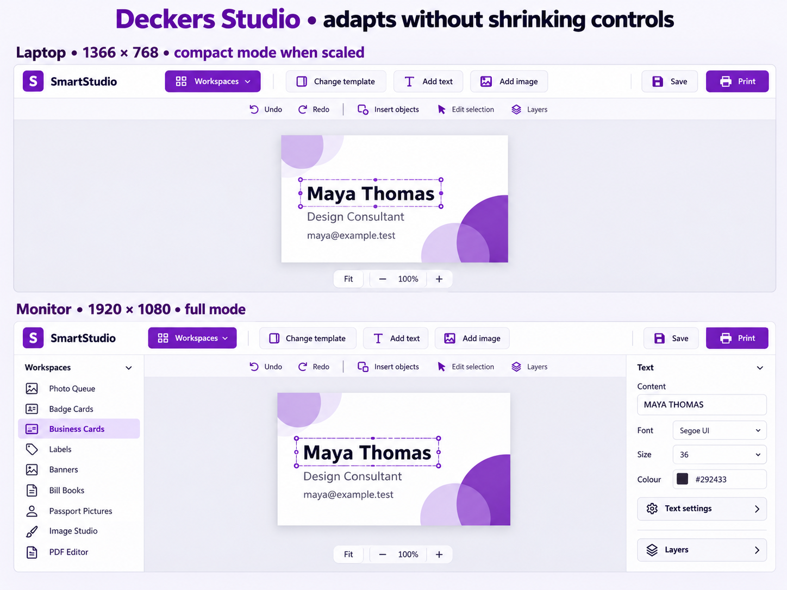

Use logical Swing units and the usable graphics configuration bounds, not physical pixels alone. Reserve actual OS/window insets at runtime. The planning matrix conservatively reserves 64 physical pixels vertically for taskbar and decoration; it is a sizing model, not a measurement of every Windows setup.

| Physical display | Scale | Estimated usable logical size | Navigation / settings mode |
| --- | --- | --- | --- |
| 1366 × 768 | 100% | 1366 × 704 | Sidebar + short inspector |
| 1366 × 768 | 125% | 1092 × 563 | Workspaces button + Edit selection dialog |
| 1366 × 768 | 150% | 910 × 469 | Workspaces button + sectioned dialog |
| 1920 × 1080 | 100% | 1920 × 1016 | Sidebar + short inspector |
| 1920 × 1080 | 125% | 1536 × 812 | Sidebar + short inspector |
| 1920 × 1080 | 150% | 1280 × 677 | Sidebar + short inspector |

Switch to compact mode when usable width is below 1200 or height below 620. Sidebar width 184, inspector width 280, gaps 16. In compact mode neither consumes permanent canvas space; retain visible Workspaces and Edit selection buttons. Never replace them with unlabelled icons. Keep a 56-unit header, two 52-unit action/context rows and a 32-unit status/zoom row. At the tightest model this leaves approximately 277 units for the canvas. Small, but usable with Fit and zoom; fine visual work benefits from a larger display.

At compact widths the first command row contains Change template, Add text, Add image, Save and Print (budget 640 units). The context row contains Undo/Redo only where supported, Insert objects, Edit selection and Layers; specialist commands replace these by workspace. Full export options live behind a labelled Export… button in this row. No horizontal tool-strip scrolling. On full layouts, template metadata belongs in the context row, not an extra toolbar row. When the inspector is closed, leave its labelled opener available.

Typography: Segoe UI or the established platform UI font; body 16, secondary 15, panel title 20, screen title 24. Primary targets 44 units high, secondary targets at least 40; fields 40–44. Use 8/16/24 spacing. Do not reduce fonts to fit. At 150%, a 44-unit button is approximately 66 physical pixels high. Scale-aware icons must remain supplementary to labels.

## Task walkthrough and acceptance checks

| Task | Expected route | Acceptance |
| --- | --- | --- |
| Choose template | Workspaces → Business Cards → Change template → select → Open | Preview and Open remain visible; Cancel does not replace current document |
| Edit text | Select name → short inspector or Edit selection → Text settings → Apply | Selection retained; existing undo restored where supported; no stale-object edits |
| Edit image | Add image → select → Edit selection → size/crop settings | Aspect ratio/transparency behaviour preserved; dialog returns to same zoom |
| Process photo | Image Studio → Choose image → settings → Process image → Result → Save PNG | Source/result states clear; supported progress/cancel works; save disabled until valid result |
| Passport output | Photo Queue → Use in Passport Pictures → Frame photo → Print | Format and sheet visible; Mark printed explicit; cancelled print does not mark queue item |
| Organise PDF | Open → select pages → Organise pages → move/rotate → Apply → Save as | Selection/count visible; PDF undo/redo works; cancel draft leaves original unchanged |
| Print publication | Print setup → paper/layout → preview → Print | Existing numbering, merge data, page order, margins and Riso options remain reachable |

Test keyboard-only navigation, visible focus, screen-reader labels, selection by keyboard, disabled-action explanations and focus restoration. Colour alone must not convey active, failed or disconnected state. Normal text should meet 4.5:1 contrast; focus/control boundaries should meet 3:1 where applicable. Tooltips supplement labels and never carry the only explanation of an action.

## Implementation handoff after direction selection

1. **Shared shell and tokens:** evolve StudioWorkspaceShell into navigation, command row, contextual row, canvas and optional inspector regions. Use shared Deckers component styling with Studio-scoped semantic theme roles and scale-aware spacing. Move existing listeners/actions into shared labelled command components without duplicating models or permissions. No public API or database changes.
2. **Dialog foundation:** introduce a bounded task-dialog wrapper with fixed actions, section navigation, focus restoration and explicit draft Apply/Cancel semantics. Migrate existing formatting controls without stale selection writes. Add responsive mode decisions from usable window dimensions and minimum control sizes.
3. **Representative editor:** migrate Business Cards first, then Badge Cards. Validate template open/save, layers, formatting, copy/paste, drag/drop and print before sharing the shell with Labels, Banners and Bill Books. Preserve specialised printing and data controls instead of flattening them into a generic form.
4. **Specialist workspaces:** migrate Image Studio, Passport Pictures, Photo Queue and PDF Editor using their own command sets. Preserve background workers, queue retention, server capability checks, errors and existing security enforcement. Avoid adding unsupported undo or processing options.
5. **Regression and native acceptance:** expand layout tests for six size/scale combinations; verify actual control bounds and dialog actions, not merely screenshots. Run SmartStudio and affected SmartStock tests, repository security check and diff whitespace check. Then perform native Windows keyboard, scaling, dialog and installed-app checks. Verify real printer output separately before release. No packaging, installation or publication is authorised by this design phase.

Future internal component names are implementation choices; required behaviour is the contract above. Do not replace existing public service APIs or template/document formats for visual changes.

## Validation evidence and remaining limits

Completed: source inspection; isolated renders of four existing panels; visual inspection of all generated previews; six-case arithmetic layout budget check; proposed palette contrast checks; report link/image integrity and scoped whitespace checks. The exact automated results are stored in validation.json. Reproduce numerical checks with validate_report.py.

Sizing validation checks the written specification, not controls embedded in AI-generated artwork. Generated images may use extra decoration, slightly different dimensions, tiny icons or sample fonts; these are recorded deviations and must not override the text specification. The images have been kept at their natural aspect ratio without stretching.

Not yet verified: native Windows application at all six configurations, actual dialog focus/keyboard behaviour, live authenticated server/queue/model availability, installed-app operation and physical printer output. No app tests were rerun for documentation-only additions, and no hardware, database, service, NFC or drawer interaction occurred. Do not read this report as proof of deployed usability or print accuracy.

**Next acceptance step:** verify the built application with the store's actual Windows scaling, printers and authenticated workflows before release.
